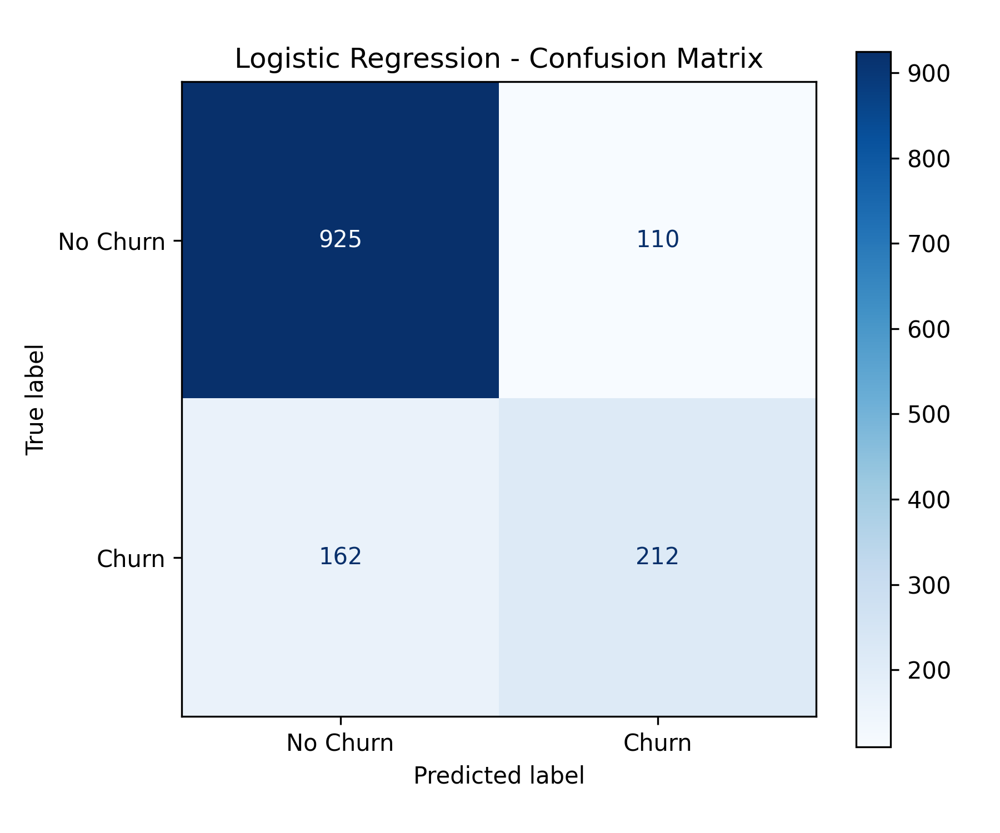
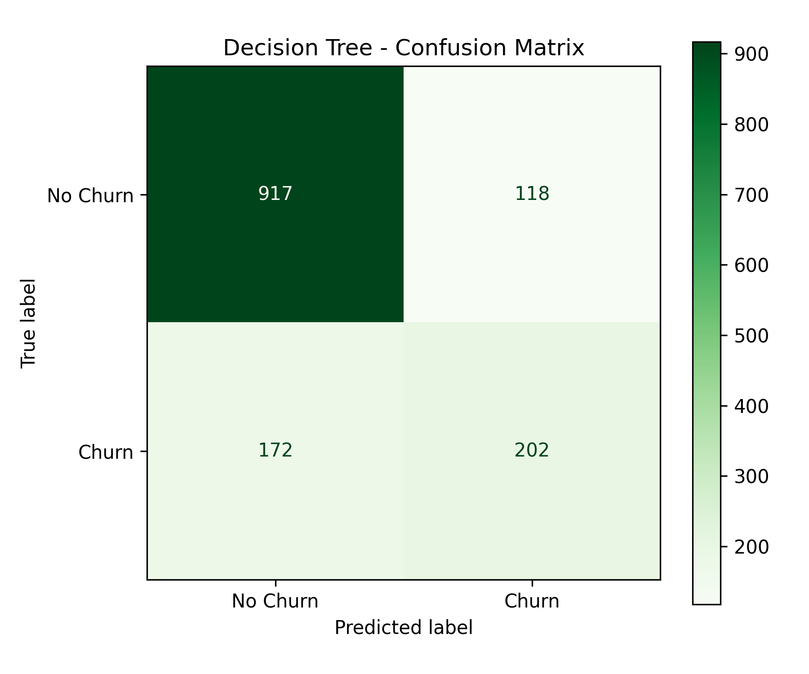
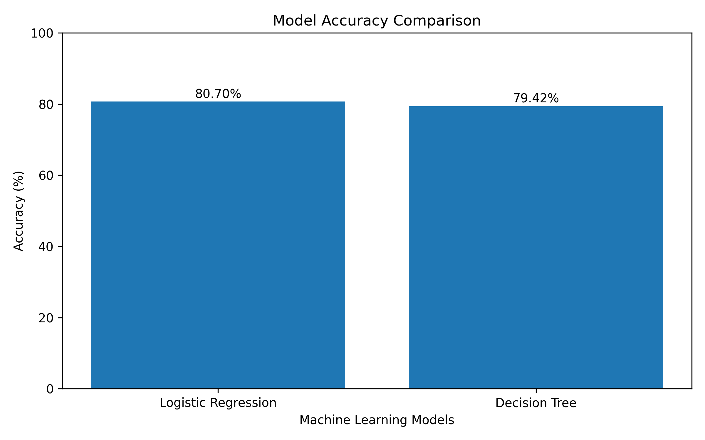

# Week 6: Customer Purchase / Churn Predictor

## Project Overview
This project implements two supervised Machine Learning classification algorithms to predict customer churn using the preprocessed Telco Customer Churn dataset.

## Algorithms Used
1. Logistic Regression
2. Decision Tree Classifier

## Tools and Libraries
- Python
- Pandas
- NumPy
- Matplotlib
- Scikit-learn
- Google Colab

## Dataset
The preprocessed training and testing datasets generated during Week 5 were used.

## Model Accuracy Comparison

| Model | Accuracy |
|---|---:|
| Logistic Regression | [80.69]% |
| Decision Tree | [79.42]% |

## Confusion Matrix Visualizations

### Logistic Regression

### Decision Tree

### Accuracy Comparison

## Key Findings
- Both classification models were trained using the same training dataset.
- Predictions were generated using the unseen test dataset.
- Accuracy and confusion matrices were used to evaluate model performance.
- [Enter which model performed better and explain your actual results.]
- Churn-class recall was also considered when comparing the models.

## Conclusion
This project demonstrates the application of Logistic Regression and Decision Tree algorithms for binary customer churn classification. The evaluation results help identify a suitable model for predicting customer churn.
